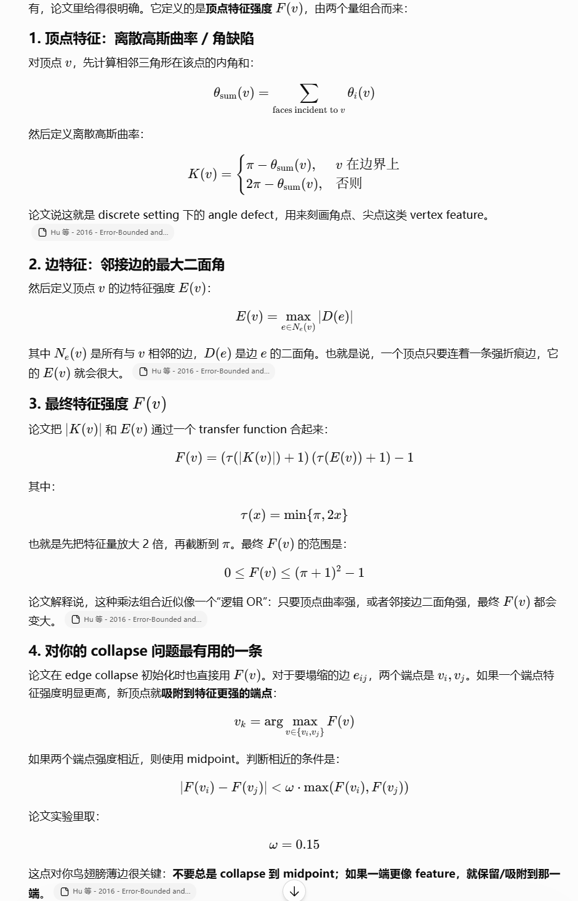

# v2.8.3 修改方向：feature-aware collapse placement

## 背景问题

v2.8.2 已经处理了两个稳定性问题：

1. 将 `code` variant 的 `splitFactor` 调整为 `1.65`，扩大 split/collapse 阈值迟滞区间。
2. 为 `flipEdges()` 增加二面角约束，避免 flip 穿过锐特征或引入新的强折角。

但当前仍有一个 collapse 相关风险：`collapseShortEdges()` 选中一条短边后，后续验证和执行都默认把新点放在 edge midpoint。

当前代码中的关键位置：

```cpp
// collapseValid()
const Eigen::Vector3d midpoint =
    0.5 * (mesh.vertices[static_cast<std::size_t>(a)] +
           mesh.vertices[static_cast<std::size_t>(b)]);
```

```cpp
// collapseEdgesBatch()
ops.push_back({keep, remove,
    0.5 * (mesh.vertices[static_cast<std::size_t>(a)] +
           mesh.vertices[static_cast<std::size_t>(b)])});
```

这会导致一个问题：如果短边的一端是尖点、折痕点或薄片边缘上的强特征点，collapse 到 midpoint 会把该点向内拉，进而造成局部轮廓收缩。此前 T21 鸟边缘/翅膀边缘的诊断也显示，最大 inward 跳变优先出现在 collapse 后，因此 v2.8.3 应优先改 collapse placement。

## 修改目标

实现 feature-aware collapse placement：

```text
collapse 时不再总是落到 midpoint；
如果待塌缩边的一端明显更像 feature，则把新点放到该强特征端点；
如果两端特征强度接近或都很弱，则仍使用 midpoint。
```

该修改只改变 collapse 新点位置的选择，不改变：

```text
1. split/collapse 阈值关系；
2. flip 二面角约束；
3. split/collapse/flip/smooth 的阶段顺序；
4. target field 构建方式；
5. MLS projection 逻辑。
```

## 顶点特征强度定义

对每个顶点 `v` 定义特征强度 `F(v)`，由两部分组合：

```text
1. 顶点特征：角缺陷；
2. 边特征：邻接边最大二面角。
```

### 1. 顶点角缺陷 K(v)

先统计所有 incident faces 在顶点 `v` 处的内角和：

```text
theta_sum(v) = sum theta_i(v)
```

然后定义离散角缺陷：

```text
K(v) = pi  - theta_sum(v),  v 在边界上
K(v) = 2pi - theta_sum(v),  v 在内部
```

实现时可以复用当前 mesh 的 face/vertex 邻接关系。边界点可由 `boundaryVertices(mesh)` 判断。

### 2. 邻接边最大二面角 E(v)

对顶点 `v` 的所有邻接边 `e`，取该边两侧三角形法向夹角的最大值：

```text
E(v) = max |D(e)|
```

其中 `D(e)` 是边 `e` 的二面角。对于边界边或非双面边，v2.8.3 初版建议按以下规则处理：

```text
1. 如果 edge incident face count == 2，则计算两侧面法向夹角；
2. 否则跳过该边，不参与 E(v) 最大值；
3. 如果顶点没有任何可计算二面角的邻接边，则 E(v) = 0。
```

原因：当前 `collapseShortEdges()` 已跳过边界顶点，v2.8.3 不需要把边界二面角策略扩大到更复杂场景。

### 3. 转换函数 tau(x)

对角缺陷和二面角做截断放大：

```text
tau(x) = min(pi, 2x)
```

也就是先把信号放大 2 倍，再截断到 `pi`。

### 4. 最终特征强度 F(v)

将角缺陷和二面角组合为：

```text
F(v) = (tau(abs(K(v))) + 1) * (tau(E(v)) + 1) - 1
```

范围为：

```text
0 <= F(v) <= (pi + 1)^2 - 1
```

这个组合近似一个逻辑 OR：只要顶点角缺陷强，或者邻接边二面角强，最终 `F(v)` 都会变大。

## collapse placement 规则

对待塌缩边 `(vi, vj)`：

```text
Fi = F(vi)
Fj = F(vj)
Fmax = max(Fi, Fj)
```

默认阈值：

```text
omega = 0.15
feature_epsilon = 1e-12
```

新点位置规则：

```text
if feature_aware_collapse == false:
    使用 midpoint

else if Fmax <= feature_epsilon:
    使用 midpoint

else if abs(Fi - Fj) < omega * Fmax:
    使用 midpoint

else if Fi > Fj:
    使用 vi 的原始位置

else:
    使用 vj 的原始位置
```

含义：

```text
1. 两端都没有明显特征时，不改变现有 midpoint 行为；
2. 两端特征强度接近时，不偏向任何一端；
3. 一端明显更强时，保留强特征端点位置，减少尖点、折痕和薄边轮廓被向内拉。
```

## 代码修改方案

目标文件：

```text
cpp_adaiso/include/adaiso/AdaIsoRemesher.hpp
cpp_adaiso/src/AdaIsoRemesher.cpp
cpp_adaiso/src/main.cpp
```

### 1. 新增配置项

在 `AdaIsoConfig` 中新增：

```cpp
bool feature_aware_collapse = true;
double collapse_feature_omega = 0.15;
```

建议在 `remesh()` 开始阶段增加参数校验：

```text
collapse_feature_omega 必须 finite 且 >= 0
```

### 2. 新增 CLI 参数

新增：

```text
--feature-aware-collapse <0|1>
--collapse-feature-omega <v>
```

默认行为：

```text
--feature-aware-collapse 1
--collapse-feature-omega 0.15
```

### 3. summary JSON 新增字段

在 `"parameters"` 中新增：

```json
"feature_aware_collapse": true,
"collapse_feature_omega": 0.15
```

这样 v2.8.2 和 v2.8.3 的实验结果可以直接通过 summary 复现和对比。

### 4. 新增内部计算函数

建议新增内部函数：

```cpp
std::vector<double> computeVertexFeatureStrengths(const Mesh& mesh);
```

该函数负责：

```text
1. 根据 vertexFaces 计算 theta_sum(v)；
2. 根据 boundaryVertices 判断角缺陷使用 pi 还是 2pi；
3. 根据 edgeFaces 和 face normals 计算邻接边最大二面角；
4. 组合得到 F(v)。
```

角度计算需做 clamp：

```text
cos(theta) clamp 到 [-1, 1]
```

退化三角形或零长度边导致角度不可计算时，应跳过该 face 对应贡献，避免产生 NaN。

### 5. 新增 collapse point 选择函数

建议新增：

```cpp
Eigen::Vector3d collapsePoint(
    const Mesh& mesh,
    int a,
    int b,
    const std::vector<double>& feature_strengths) const;
```

该函数统一实现 placement 规则，返回 midpoint 或强特征端点。

### 6. 修改 collapseShortEdges()

当前 `collapseShortEdges()` 每个 pass 会重新构造：

```cpp
boundary
e2f
neigh
vf
```

v2.8.3 应在同一个 pass 内额外计算：

```cpp
const auto feature_strengths = computeVertexFeatureStrengths(mesh);
```

并将 `feature_strengths` 传给：

```text
collapseValid()
collapseEdgesBatch()
```

注意：feature strength 应基于当前 pass 的 mesh 重新计算。因为上一 pass 的 collapse 会改变局部拓扑和角度关系。

### 7. 修改 collapseValid()

`collapseValid()` 当前默认使用 midpoint 做两类检查：

```text
1. collapse 后邻边不能超过 split 阈值；
2. collapse 后局部三角形质量不能低于 min_quality_after_collapse。
```

v2.8.3 必须把 midpoint 替换为统一的 collapse point：

```cpp
const Eigen::Vector3d candidate = collapsePoint(mesh, a, b, feature_strengths);
```

之后所有 `midpoint` 用途都改为 `candidate`：

```text
1. related neighbor length check 使用 candidate；
2. targetAt(candidate) 使用 candidate；
3. pointAt(keep) 返回 candidate；
4. triangle quality check 使用 candidate。
```

这是关键一致性要求：不能出现验证用 midpoint、执行用 endpoint 的情况。

### 8. 修改 collapseEdgesBatch()

`collapseEdgesBatch()` 当前为每个 collapse op 写入 midpoint。v2.8.3 应改为：

```text
1. 根据同一份 feature_strengths 计算 candidate；
2. keep/remove 仍沿用当前 min/max index 策略；
3. mesh.vertices[keep] 写入 candidate；
4. face 中 remove 替换为 keep；
5. removeDegenerateFaces(mesh) 保持不变。
```

注意：即使 candidate 等于 remove 端点的原始位置，也不需要改变 keep/remove 的索引策略。只需要把 keep 顶点坐标写成 remove 端点坐标即可，这样可以避免大改拓扑替换逻辑。

## 预期影响

正向预期：

```text
1. 减少 collapse 对尖点、折痕、薄边轮廓的 inward 拉动；
2. 降低 T21 鸟边缘/翅膀边缘的 collapse 后最大阶段跳变；
3. 在不显著增加顶点数的前提下改善局部几何保持；
4. 与 v2.8.2 flip 二面角约束互补：flip 保护边翻转，collapse placement 保护边塌缩。
```

可能代价：

```text
1. collapse 后局部边长分布可能更不均匀；
2. 部分端点保留会降低局部规则化效果；
3. Qavg 可能略降，Qmin 取决于质量检查是否足够严格；
4. 如果 omega 太小，过多 collapse 会偏向端点；如果 omega 太大，效果会接近 midpoint。
```

## 风险与边界

v2.8.3 初版只解决 collapse placement，不解决所有 collapse 风险。

本次不纳入：

```text
1. 新分裂顶点 age < 1 时禁止参与 collapse；
2. collapse 阶段新增法向变化硬约束；
3. 每轮结束后重新计算 curvature -> CSF -> target field；
4. 改成先 collapse 后 split；
5. 改变 keep/remove 顶点索引策略。
```

如果 v2.8.3 后仍出现明显收缩，应继续考虑：

```text
1. collapse 法向变化保护；
2. split 顶点冷却；
3. tangent smoothing 的特征区域权重衰减；
4. 每轮重算 target field。
```

## 建议实验

### 主对照实验

基线：

```text
v2.8.2
split_factor = 1.65
collapse_factor = 0.8
max_flip_dihedral_degrees = 45
feature_aware_collapse = false
```

v2.8.3：

```text
split_factor = 1.65
collapse_factor = 0.8
max_flip_dihedral_degrees = 45
feature_aware_collapse = true
collapse_feature_omega = 0.15
```

T21 主测参数：

```text
model = T21
iters = 10
target_min_factor = 0.20
target_max_factor = 1.8
target_size_gamma = 2.0
preprocess = 0
project = 1
cd_samples = 100000
```

建议输出：

```text
summary.json
target_field/
iteration_meshes/
all_stage_meshes/
```

重点观察：

```text
1. 翅膀/鸟边缘 ROI mean inward、p95 inward、max inward；
2. collapse 后阶段跳变是否下降；
3. CD / RMSE；
4. Qavg / Qmin；
5. violation_rate；
6. split_count / collapse_count / flip_count；
7. output vertices / faces。
```

### omega 消融实验

建议比较：

```text
omega = 0.10
omega = 0.15
omega = 0.25
```

判断标准：

```text
1. omega 越小，越容易选择强特征端点；
2. omega 越大，越容易回退到 midpoint；
3. 若 Qmin 明显下降，说明端点保留过激；
4. 若 inward 改善不明显，说明 omega 可能过大或 collapse 收缩来自其他阶段。
```

## 测试计划

构建：

```powershell
cmd /c "call ""C:\Program Files\Microsoft Visual Studio\18\Community\Common7\Tools\VsDevCmd.bat"" -arch=x64 && cmake --build cpp_adaiso/build --target adaiso_cli adaiso_tests"
```

测试：

```powershell
ctest --test-dir cpp_adaiso/build --output-on-failure
```

建议新增或补充单元测试：

```text
1. 平坦区域 collapse 仍落到 midpoint；
2. 一端为尖点或折痕强特征时，collapse point 落到强特征端点；
3. feature_aware_collapse=false 时保持 v2.8.2 midpoint 行为；
4. collapse_feature_omega 增大时，相近特征强度回退到 midpoint；
5. collapseValid() 使用的 candidate 与 collapseEdgesBatch() 实际写入的 candidate 一致。
```

## 参考截图

原始讨论截图如下，保留用于追溯公式来源和实现动机：


