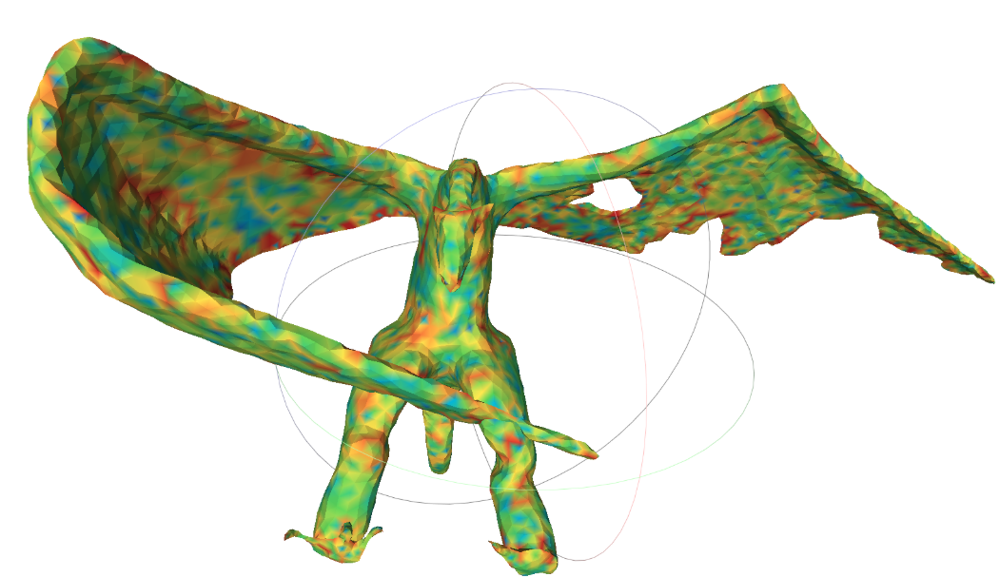

# 探究最终output的长度场是否符合目标场

这张 `output_edge_ratio_max_heat.ply` 说明的是：

每个顶点附近，**最长/最不满足目标尺寸的邻接边**相对于目标尺寸场有多长。

它的数值是：

```text
vertex_value(v) = max edge_length(e) / min(target_h(a), target_h(b))
```

其中 `e` 是和顶点 `v` 相邻的边。

颜色含义：

```text
蓝/青色：附近最长边仍偏短或较接近目标下限
绿色：附近最长边大致在合理范围中部
黄色：附近存在比较长的边
红色：附近至少有一条边接近或超过 split 阈值
```

当前色标固定是：

```text
0.8 -> 1.65
```

也就是说：

```text
ratio ≈ 1.0   边长接近目标尺寸
ratio ≈ 1.45  偏长，但通常还在允许范围内
ratio >= 1.65 超过 split 阈值，理论上应继续细分
```

从这张图看，T21 最终结果整体不是大片纯红，而是以绿、黄为主，说明多数区域的最长邻接边还在可接受范围内；但翅膀边缘、破洞边界、躯干-翅膀连接处、脚/尖端附近有不少红色斑块，说明这些局部存在**相对目标尺寸偏长的边**。

结合 T21 的统计：

```text
p95_ratio      = 1.4502
p99_ratio      = 1.5871
ratio_max      = 1.7482
violation_rate = 0.02844
```

可以这样解读：

- 95% 的边低于 `1.45`，整体已经基本贴近目标尺寸场。
- 99% 的边低于 `1.59`，大部分边没有超过 split 阈值。
- 少量边超过 `1.65`，所以图上出现局部红斑。
- `violation_rate = 2.84%`，说明最终仍有约 2.84% 的边太短或太长，其中这张图主要暴露“太长”的位置。

所以这张图的结论是：**最终网格整体满足目标尺寸场，但复杂边界和细长结构处仍有局部边偏长，特别是翅膀破洞边缘和尖端区域。**

# 探究平均曲率信号-》平均曲率，从信号场变成真实的物理场，对脚趾等曲率高的地方的细节保持是否能提高/cd是否能提高
GPT的回答是：因为当前算法会重新求 lambda 匹配目标面数，全局尺度基本会被抵消。除非你改变的是曲率的空间分布，否则这个实验信息量不大。

# 探究 在平均曲率下， target_h 的公式中开根号（几何误差） 与 不开根号（法线偏移误差） 下对曲率高的地方的细节是否能提高
那就不做了

# 探究 在平均曲率信号下， target_h 的公式中开根号（几何误差） 与 不开根号（法线偏移误差） 下对曲率高的地方的细节是否能提高


