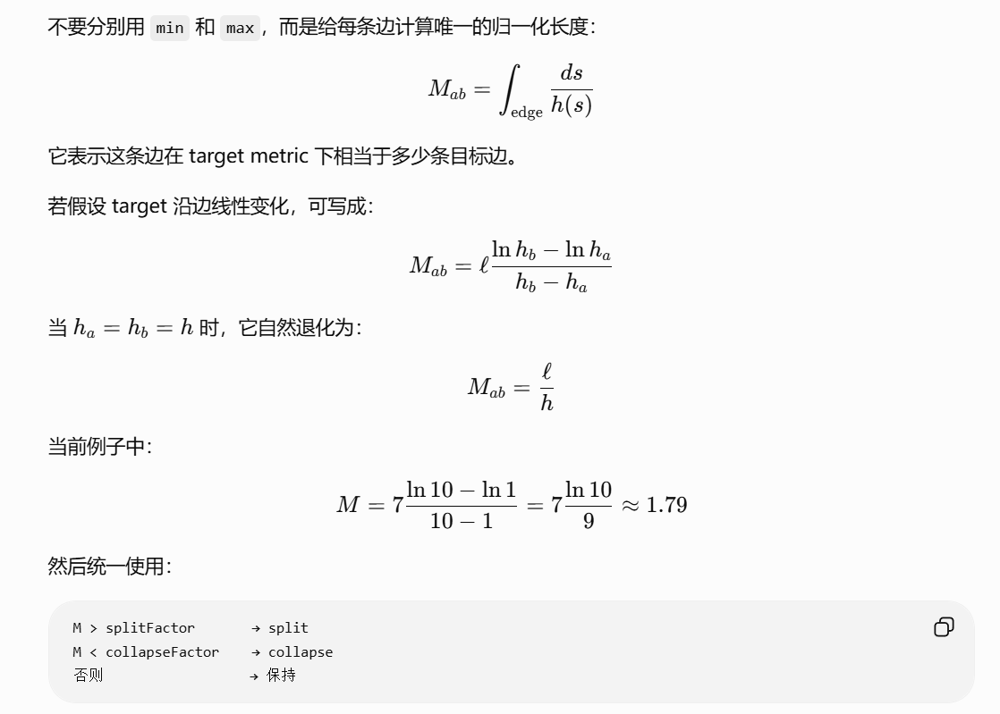

在分裂和塌缩的时候，使用边的度量长度判断分裂还是塌缩

# v5.0.2 Metric Edge Length Update

## Summary
把 split/collapse 的阈值判断从“欧氏边长 / 端点 min/max target”改为每条边唯一的 target metric length：

`M_ab = integral_edge ds / h(s)`

当端点 target 为 `h_a, h_b` 且沿边线性变化时：

`M_ab = length * (log(h_b) - log(h_a)) / (h_b - h_a)`

若 `h_a ~= h_b`，退化为 `length / h_a`。之后统一使用：

- `M_ab > splitFactor()` 执行 split
- `M_ab < collapseFactor()` 执行 collapse
- 其他情况保持

## Key Changes
- 在 `AdaIsoRemesher.cpp` 增加内部 helper，例如 `targetMetricLength(length, h_a, h_b)` 和 `edgeTargetMetricLength(mesh, target_field, a, b)`；要求长度和 target 有限且 target 为正。
- `splitLongEdges()` 改用 `M_ab` 收集、排序和二次确认候选边；split 候选按 `M_ab` 从大到小处理。
- `collapseShortEdges()` 改用 `M_ab` 收集、排序和二次确认候选边；collapse 候选按 `M_ab` 从小到大处理。
- `collapseValid()` 中“塌缩后新边不能超过 split 阈值”的检查改用 candidate 到邻点的 metric length，而不是欧氏长度乘端点 target。
- `flipEdges()` 中新边 `c-d` 的合法区间检查改为 `collapseFactor() <= M_cd <= splitFactor()`。
- 保留现有 `targetMetricSplitParameter()` 的 metric midpoint 逻辑；它已经与线性 target 下的等 metric split 位置一致。
- `computeEdgeRatioStats()` 和输出诊断改用 `M_ab` 作为 ratio 统计值；保留 `EdgeRatioStats` 字段名以避免公共结构体大改，但将 JSON/CSV 的字段描述更新为 metric length 语义。
- 不再让 remesh 行为依赖 `collapseUsesMaxReference()`；该公开方法暂时保留以减少外部编译破坏，但实现路径不再调用它。
- 更新 `CHANGELOG.md` 增加 v5.0.2 条目；将 `CMakeLists.txt` 项目版本改为 `5.0.2`。

## Test Plan
- 新增或扩展单元测试覆盖 metric length 公式：
  - `h_a == h_b` 时 `M = length / h`。
  - `h_a != h_b` 时验证 `length * (log(h_b)-log(h_a))/(h_b-h_a)`。
  - 非有限值、非正 target 不参与统计或按现有错误策略处理。
- 更新 `testEdgeRatioStats()`：常量 target 仍保持旧数值，新增变 target 用例验证统计值使用 metric length 而非 `length / min(target)`。
- 新增 split/collapse 行为回归：构造一条边使 `length/min(h)` 会触发、但 `M_ab` 不触发，确认 v5.0.2 后按 `M_ab` 判断。
- 更新 target-field diagnostic 测试中的 CSV header 和 JSON field 字符串期望。
- 构建并运行：
  - `cmake --build cpp_adaiso/build --target adaiso_tests adaiso_cli`
  - `cpp_adaiso/build/adaiso_tests.exe`

## Assumptions
- “分裂和塌缩的时候”包括候选收集、二次确认、collapse 有效性保护和 flip 新边合法性检查，确保所有阈值判断语义一致。
- 保留现有 split 插点 clamp `[0.25, 0.75]`，本次只改变“是否 split/collapse”的边度量判断。
- 未跟踪的 `v5.0.2 修改方向.md` 和 `image-4.png` 作为需求来源保留，不纳入代码修改范围，除非后续要求提交文档。
