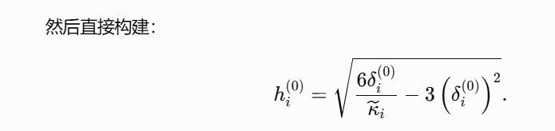

# v5.1.5 修改计划：基于输入分辨率的 CSF 曲率尺寸场

## 1. 核心方向

v5.1.5 的目标不是重写 remeshing 主流程，而是替换当前自动目标误差 `target_error_delta` 的估计方式。

当前主流程可以保持不变：

```text
输入网格 -> raw curvature -> CSF curvature -> target length field -> remeshing -> error validation
```

本版修改重点是：用输入网格自身的局部分辨率和 CSF 后曲率估计一个全局初始容差 `delta_0`，再用 `delta_0` 反推每个顶点的目标边长 `h_i`。

也就是说，公式里的曲率都优先使用 CSF 后曲率，而不是 raw curvature。




## 2. 现有代码对应关系

当前代码入口已经基本匹配这个方向：

```cpp
raw_curvature = computeRawCurvatureField(mesh, config_.curvature_mode);
curvature = solveCsf(mesh, raw_curvature);
sizing = targetErrorCurvatureLengths(mesh, curvature, ...);
```

所以 v5.1.5 应优先改 `targetErrorCurvatureLengths` 里的自动 `target_error_delta == 0` 分支，而不是改 split/collapse/flip/smoothing 主流程。

## 3. 拟采用的尺寸场定义

### 3.1 曲率

对每个顶点 `i`：

```text
kappa_i = raw principal-max curvature
kappa_tilde_i = CSF(kappa_i)
```

后续估计 `delta_i` 和 `h_i` 时使用：

```text
kappa_used_i = max(kappa_tilde_i, epsilon_k)
```

其中 `epsilon_k` 可先复用代码里的 `kTargetKappaMin`。

### 3.2 输入局部尺度

对每个顶点 `i`，定义输入网格的局部边长尺度：

```text
l_i = median length of incident edges around vertex i
```

这里的 `incident edges` 指所有与顶点 `i` 相连的边。

算法前提是参与 remeshing 的三角网格不存在孤立点。若输入 `vertices` 中存在没有被任何 face 引用、也没有 incident edge 的孤立顶点，应在 `mesh.validate` 或 preprocess 阶段删除或报错，而不应参与尺寸场估计。尺寸场构建阶段不为孤立点定义 `l_i`。

### 3.3 局部初始容差

用小误差近似估计输入网格本身在该点的局部分辨误差：

```text
delta_i = kappa_used_i * l_i^2 / 6
```

这里的含义是：把输入网格当前的典型离散精度当作自动初始容差来源，而不是人工指定 `N` 或固定使用 `0.5 * mean_edge_length`。

### 3.4 全局初始容差

从所有顶点的 `delta_i` 取面积加权分位数：

```text
delta_0 = weighted_quantile(delta_i, vertex_area_i, q)
```

面积加权分位数的含义是：不是每个顶点投一票，而是每个顶点按它代表的曲面面积投票。

普通分位数等价于：

```text
每个 delta_i 的权重相同
```

面积加权分位数使用：

```text
weight_i = vertex_area_i
```

其中 `vertex_area_i` 可先用 barycentric vertex area：

```text
vertex_area_i = sum(area(face) / 3), for all incident faces of vertex i
```

这样 `delta_0` 表示曲面面积意义下的典型输入分辨误差，而不是顶点数量意义下的典型误差。这样可以避免局部高密度小三角区域因为顶点数量多而过度影响全局自动容差。

例子：

```text
delta_i:       0.01   0.02   0.10   0.20
vertex_area:   10     10      1      1
```

总权重是 `22`，50% 权重位置是 `11`。按 `delta_i` 从小到大累加面积权重：

```text
0.01 -> 10
0.02 -> 20
```

到 `0.02` 时已经超过 50% 权重，所以面积加权中位数 `Q0.5 = 0.02`。

建议默认：

```text
q = 0.5
```

含义是取面积加权中位数，压缩更强，作为默认自动容差。

保守实验可使用：

```text
q = 0.95
```

含义是更接近“尽量都满足输入分辨率”，输出面数会更大，适合作为对照实验参数。

## 4. 用 delta_0 构建目标边长

每个顶点的目标边长由 CSF 后曲率和全局容差反推：

```text
h_i = sqrt(6 * delta_0 / kappa_used_i - 3 * delta_0^2)
```

如果根号内非正或非有限，应回退到安全值，而不是让程序报错中断整批实验。

初步回退策略：

```text
h_i = h_max
```

然后统一截断：

```text
h_i = clamp(h_i, h_min_safe, h_max)
```

其中：

```text
h_max = target_h_max_factor * mean_edge_length
```

`h_min_safe` 需要在代码中明确。初步建议：

```text
h_min_safe = 0.25 * mean_edge_length
```

这个值后续可以暴露为参数，但 v5.1.5 第一版可以先作为内部默认常量，避免极高曲率区域生成过小边长导致面数爆炸。

## 5. 和 v5.1.4 的主要区别

v5.1.4 当前自动 delta 更偏向通过全局参考曲率 `kappa_ref` 和 `target_error_h_ref_factor` 推出一个统一误差，再用：

```text
h_min = f(delta, kappa_ref)
h_i = h_min * sqrt(kappa_ref / kappa_i)
```

v5.1.5 改为：

```text
先用输入局部尺度 l_i 和 CSF 曲率估计 delta_i
再从 delta_i 得到 delta_0
最后直接用 delta_0 和每点 CSF 曲率反推 h_i
```

直观差别是：v5.1.5 的自动容差来自输入网格已有分辨率，而不是来自一个人为的 `h_ref_factor`。

## 6. 参数建议

第一版只需要最少参数：

```text
--auto-delta-quantile <0..1>
```

默认：

```text
0.5
```

可选实验：

```text
0.95
```

已有参数继续保留：

```text
--curvature-mode principal-max
--csf-alpha
--target-h-max-factor
--target-error-delta
```

其中 `--target-error-delta > 0` 时仍然应该覆盖自动 `delta_0`，便于做受控对照。

## 7. 实现范围

优先修改：

```text
cpp_adaiso/src/AdaIsoRemesher.cpp
cpp_adaiso/include/adaiso/AdaIsoRemesher.hpp
cpp_adaiso/src/main.cpp
```

可能需要新增的内部函数：

```text
incidentMedianEdgeLengths(mesh)
areaWeightedQuantile(values, weights, q)
autoDeltaFromInputResolution(mesh, csf_curvature, q)
```

诊断输出建议增加：

```text
auto_delta_quantile
auto_delta_source = input_resolution_csf_curvature
delta_i_min / delta_i_max / delta_i_q50 / delta_i_q95
```

如果已经导出 target field diagnostics，也应把 `delta_i` 作为 CSV 或 PLY scalar 输出，方便检查局部容差是否集中在合理区域。

## 8. 验收标准

v5.1.5 不应只看最终面数，也要看误差是否真正受 `delta_0` 约束。

建议先做小样本：

```text
T 高风险模型 + model 系列高风险模型
q = 0.5 和 q = 0.95 两组
```

记录指标：

```text
success rate
faces out/in
violation ratio
CD / RMSE / sampled Hausdorff
qavg / qmin
runtime
```

初步通过标准：

```text
1. success rate 不低于 v5.1.4
2. q=0.5 时 faces out/in 相比 v5.1.3 或 v5.1.4 有明显下降
3. CD/RMSE 不出现系统性恶化
4. violation ratio 的异常模型可以通过 q=0.95 明显改善
5. target field 可视化中，高曲率区域确实更密，平坦区域不过度加密
```

## 9. 当前不做的事

本版先不处理 hard feature 约束问题，例如 crease、corner、boundary 的显式拓扑保护。

原因是尺寸场只负责采样密度，不负责保证边、角点和 feature graph 的拓扑保持。hard feature 应该在后续版本中通过 feature detection、patch classification 和 constraint-aware operators 单独处理。
