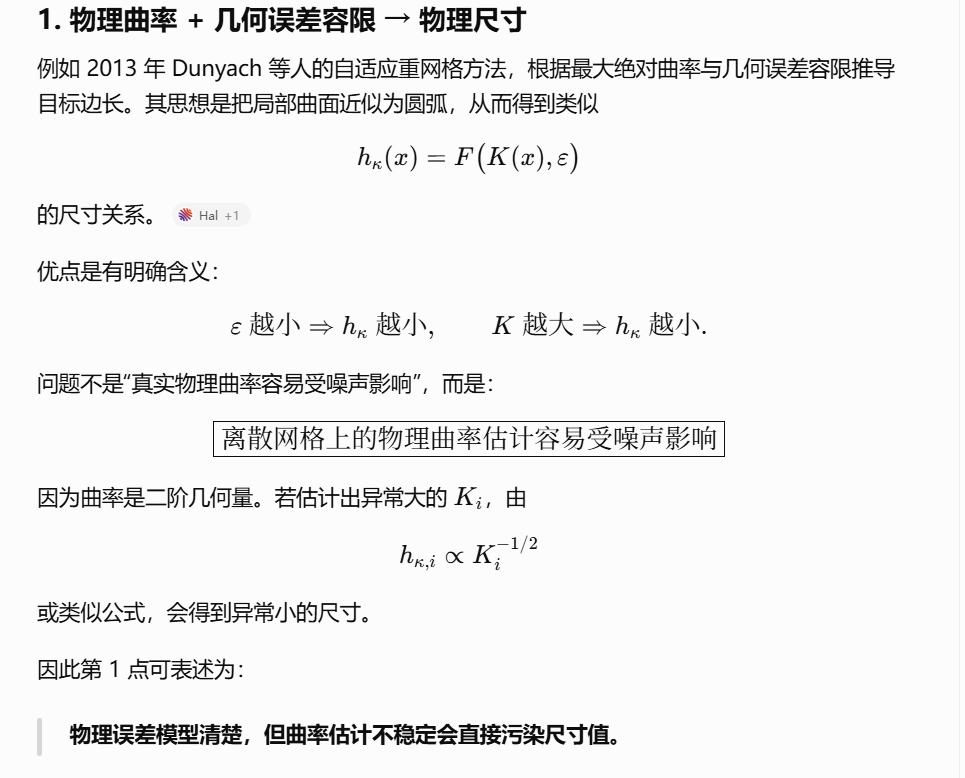
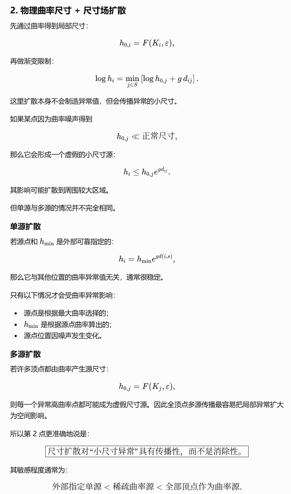
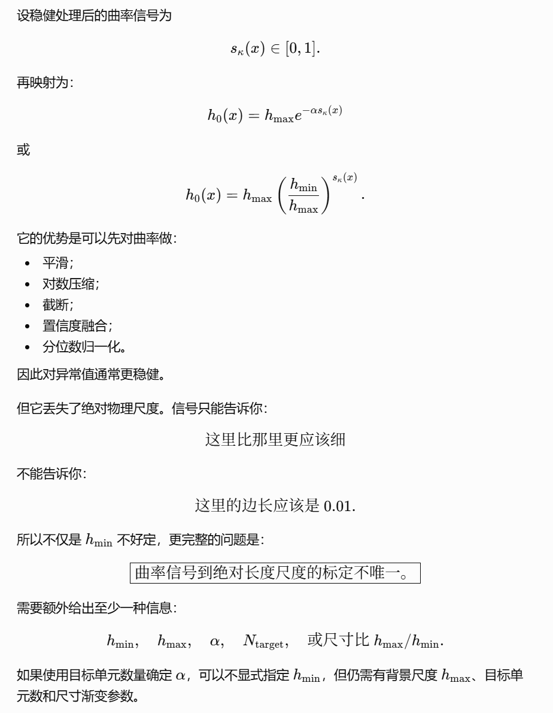

基本是这三类矛盾，但第 2 点需要更精确地区分。建议总结为：

## 1. 物理曲率 + 几何误差容限 → 物理尺寸

例如 2013 年 Dunyach 等人的自适应重网格方法，根据最大绝对曲率与几何误差容限推导目标边长。其思想是把局部曲面近似为圆弧，从而得到类似

[
h_\kappa(x)=F\bigl(K(x),\varepsilon\bigr)
]

的尺寸关系。([Hal][1])

优点是有明确含义：

[
\varepsilon \text{ 越小}
\Rightarrow h_\kappa \text{ 越小},
\qquad
K \text{ 越大}
\Rightarrow h_\kappa \text{ 越小}.
]

问题不是“真实物理曲率容易受噪声影响”，而是：

[
\boxed{\text{离散网格上的物理曲率估计容易受噪声影响}}
]

因为曲率是二阶几何量。若估计出异常大的 (K_i)，由

[
h_{\kappa,i}\propto K_i^{-1/2}
]

或类似公式，会得到异常小的尺寸。

因此第 1 点可表述为：

> **物理误差模型清楚，但曲率估计不稳定会直接污染尺寸值。**

---

## 2. 物理曲率尺寸 + 尺寸场扩散

先通过曲率得到局部尺寸：

[
h_{0,i}=F(K_i,\varepsilon),
]

再做渐变限制：

[
\log h_i
========

\min_{j\in S}
\left[
\log h_{0,j}+g,d_{ij}
\right].
]

这里扩散本身不会制造异常值，但会传播异常的小尺寸。

如果某点因为曲率噪声得到

[
h_{0,j}\ll \text{正常尺寸},
]

那么它会形成一个虚假的小尺寸源：

[
h_i
\leq
h_{0,j}e^{g d_{ij}}.
]

其影响可能扩散到周围较大区域。

但单源与多源的情况并不完全相同。

### 单源扩散

若源点和 (h_{\min}) 是外部可靠指定的：

[
h_i=h_{\min}e^{g d(i,s)},
]

那么它与其他位置的曲率异常值无关，通常很稳定。

只有以下情况才会受曲率异常影响：

* 源点是根据最大曲率选择的；
* (h_{\min}) 是根据源点曲率算出的；
* 源点位置因噪声发生变化。

### 多源扩散

若许多顶点都由曲率产生源尺寸：

[
h_{0,j}=F(K_j,\varepsilon),
]

则每一个异常高曲率点都可能成为虚假尺寸源。因此全顶点多源传播最容易把局部异常扩大为空间影响。

所以第 2 点更准确地说是：

[
\boxed{
\text{尺寸扩散对“小尺寸异常”具有传播性，而不是消除性。}
}
]

其敏感程度通常为：

[
\text{外部指定单源}
<
\text{稀疏曲率源}
<
\text{全部顶点作为曲率源}.
]

---

## 3. 曲率信号场 + 尺寸映射

设稳健处理后的曲率信号为

[
s_\kappa(x)\in[0,1].
]

再映射为：

[
h_0(x)
======

h_{\max}e^{-\alpha s_\kappa(x)}
]

或

[
h_0(x)
======

h_{\max}
\left(
\frac{h_{\min}}{h_{\max}}
\right)^{s_\kappa(x)}.
]

它的优势是可以先对曲率做：

* 平滑；
* 对数压缩；
* 截断；
* 置信度融合；
* 分位数归一化。

因此对异常值通常更稳健。

但它丢失了绝对物理尺度。信号只能告诉你：

[
\text{这里比那里更应该细}
]

不能告诉你：

[
\text{这里的边长应该是 }0.01.
]

所以不仅是 (h_{\min}) 不好定，更完整的问题是：

[
\boxed{
\text{曲率信号到绝对长度尺度的标定不唯一。}
}
]

需要额外给出至少一种信息：

[
h_{\min},\quad
h_{\max},\quad
\alpha,\quad
N_{\text{target}},
\quad\text{或尺寸比 }h_{\max}/h_{\min}.
]

如果使用目标单元数量确定 (\alpha)，可以不显式指定 (h_{\min})，但仍需有背景尺度 (h_{\max})、目标单元数和尺寸渐变参数。

---

## 可以归纳为这张表

| 方法            | 优点            | 核心问题            |
| ------------- | ------------- | --------------- |
| 物理曲率 + 误差容限   | 尺寸有几何误差含义     | 曲率估计噪声直接转化为尺寸异常 |
| 物理曲率尺寸 + 多源扩散 | 同时满足误差和渐变限制   | 异常小尺寸会被扩散传播     |
| 曲率信号 + 尺寸映射   | 有界、抗噪、网格数量较稳定 | 缺少自然的绝对尺寸标定     |
| 外部指定单源扩散      | 数学简单、稳定、可控    | 尺寸分布不自动适应全部曲率特征 |

## 最终可以概括成三个矛盾

### 物理方法

[
\boxed{
\text{尺寸尺度自然，但输入曲率不够稳健}
}
]

### 扩散方法

[
\boxed{
\text{能控制尺寸渐变，但会传播错误的小尺寸源}
}
]

### 信号方法

[
\boxed{
\text{信号稳定，但绝对尺寸尺度需要外部标定}
}
]

因此你的三点总体正确，但第 2 点建议改成：

> **物理曲率生成的尺寸异常，在多源下包络扩散中会被传播；单源是否敏感，取决于源点和 (h_{\min}) 是否由不稳定的曲率估计产生。**

另外，“Laplace 曲率信号场”最好明确是指经过 Laplacian 平滑的曲率信号，还是由离散 Laplace–Beltrami 算子计算的平均曲率；两者不是同一概念。

[1]: https://hal.science/hal-01295339/file/EGshort2013_Dunyach_et_al.pdf?utm_source=chatgpt.com "Adaptive Remeshing for Real-Time Mesh Deformation"
